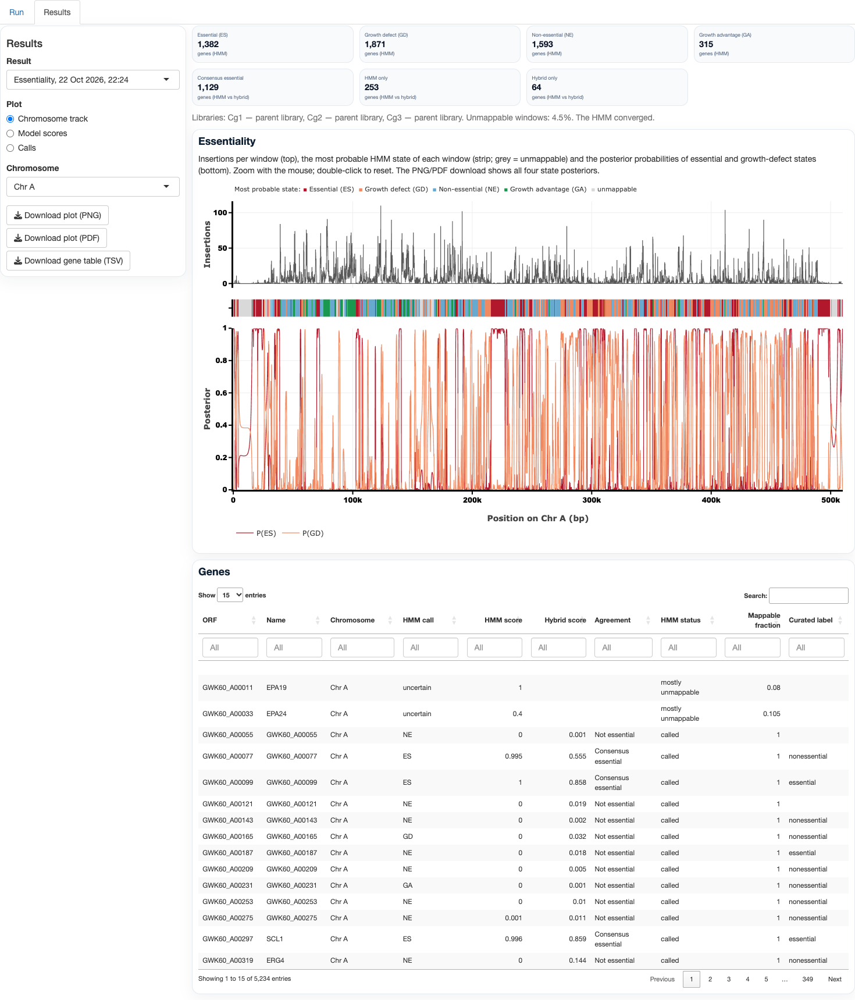

# Hermes window HMM and hybrid: essentiality

*Copied from `output/essentiality/hermes_hmm/hermes_hmm_methods.md` (the full methods write-up, with a PDF version).*

# Summary

YTAB offers two gene-essentiality models for Hermes Tn-seq, each defined by which data it needs.

| model | needs labelled genes? | role |
|---|---|---|
| **Hermes window HMM** (`hermes_hmm_v2`) | **no**: genome, annotation and Hermes libraries only | **primary model**, including organisms without essentiality labels |
| **Hybrid** (random forest on existing gene features + HMM posteriors) | **yes**: trained on labelled genes | when reliable labels exist for the organism or a close relative |

**Supervised models depend on labels.** The hybrid, the current random forest and any retrained forest
learn their decision rule from labelled genes. Their quality is therefore bounded by those labels:
- how many there are and how accurate they are;
- how relevant they are to the target species;
- for the current forest, also the training libraries.

The hybrid's HMM features are label-free, but the way it combines them is learned from labels.

**The HMM learns from the libraries alone.** All its parameters are estimated from the target
libraries by maximum likelihood (Baum–Welch). No gene label, ortholog or external training dataset
enters the fit.

The HMM adapts the TRANSIT HMM (DeJesus & Ioerger 2013; DeJesus et al. 2015) to Hermes. The
reference implementation is TRANSIT `pytransit/analysis/hmm.py`, commit 50e23d6 (7 February 2025).

**Evidence:**
- **Synthetic recovery (pre-registered):** AUC 0.967–0.999, essential-gene precision 0.92–0.96 and
  recall 0.84–0.98.
- **Multi-start check:** the fit converges to the same optimum from 8 starting points, with at most 1
  gene changing call.
- ***C. glabrata* labels:** silver AUC 0.922 and gold AUC 0.959.
- **Hybrid:** best on every metric (silver 0.947, gold 0.974). Its pre-registered gain over the same
  learner without HMM features was not significant.
- **TRANSIT's own HMM** calls no essential genes on these data.

# 1. Biological basis

- **Signal.** A gene whose disruption is lethal yields no viable insertion clones. Its coding sequence
  therefore lacks insertions in the parental pool. Growth-defect genes are under-represented rather than
  absent, and genes or regions that confer a selective advantage are over-represented.
- **Contiguity.** Essentiality is a property of contiguous DNA: whole genes, or the domains that encode
  essential functions. Neighbouring positions therefore share a state, which is the structure an HMM
  models.
- **Hermes is not Himar1.** Himar1 inserts only at TA dinucleotides, which defines a fixed set of
  insertion opportunities. Hermes:
  - targets a weak consensus (nTnnnnAn) and prefers nucleosome-free, accessible DNA (Gangadharan et al.
    2010; Guo et al. 2013);
  - in the Gale et al. (2020) libraries, only 53% of insertions match nTnnnnAn;
  - has 1.18 million motif positions (93 per kb) and a median gap between insertions of 6 bp.

  There is no site universe to walk, and insertion density varies with accessibility independently of
  fitness. Unless modelled, this accessibility variation is confounded with essentiality.
- **Pooled libraries.** Independent libraries share genomic accessibility but differ in depth and
  complexity. Joint modelling should therefore share accessibility across libraries and give each
  library its own scale.

# 2. Relation to the TRANSIT HMM

| element | TRANSIT HMM | Hermes window HMM | reason |
|---|---|---|---|
| unit | each TA site | 100-bp genomic windows | no Hermes site universe |
| observation | read count at a site (mean of replicates, rounded) | distinct insertion sites (≥ 1 read) per window, per library | site counts are robust to PCR jackpots and comparable across depths |
| states | ES, GD, NE, GA | same | same interpretation |
| emission | geometric, mean fixed at fractions of the sample mean | negative multinomial with accessibility covariates and a shared random effect | Hermes accessibility bias; overdispersion |
| parameters | fixed by formula (not trained) | **estimated by Baum–Welch** | the data determine the parameters |
| replicates | averaged into one track | emitted jointly, one depth parameter per library | keeps per-library information |
| unmappable DNA | not modelled (TA sites assumed mappable) | masked as missing emissions | repeated DNA cannot receive uniquely mapped reads |
| decoding | Viterbi | full posterior (forward–backward) | gene-level probabilities |
| gene call | ES if all sites ES, else majority state | P(run of ≥ max(3, 20% of the gene's windows) ES windows) ≥ 0.5 | captures domain-essential genes |
| on Gale 2020 | 0 ES genes | 1,382 ES genes | — |

The TRANSIT port was run on the union-site catalogue, with TTR normalization and the replicate mean
rounded as TRANSIT does. It assigns no gene to ES because its geometric emissions cannot represent the
variance of Hermes site counts.

# 3. Observations

## 3.1 Windows and counts

The genome is divided into consecutive windows $w = 1,\dots,T$ of 100 bp. For library $l = 1,\dots,L$,

$$y_{wl} = \#\{\text{distinct insertion sites in window } w \text{ with } \ge 1 \text{ read}\}.$$

The 100-bp window is shorter than most essential domains and longer than the 99th-percentile gap
between insertions (242 bp at the pooled level).

## 3.2 Mappability mask

A 50-mer start position is *unique* if its sequence occurs once in the genome on either strand. The
uniqueness test uses exact 2-bit encoding. A window is masked if ≥ 50% of its 50-mer starts are
non-unique. Masked windows emit nothing: they contribute an emission likelihood of 1 to every state.
On the *C. glabrata* CBS138 genome, 4.5% of the 126,976 windows are masked.

## 3.3 Accessibility covariates

Three covariates are computed from the genome and annotation only, and standardized to mean 0, SD 1:
- $\log(1+\text{nTnnnnAn count})$, counting both strands;
- AT fraction;
- fraction of the window outside annotated CDS.

They form $x_w \in \mathbb{R}^3$.

**Learned target preference (v3, any transposon).** The motif count encodes Hermes' consensus and means nothing for
other transposons (Ac/Ds). With `--sequence-covariate learned` (`hermes_hmm_v3`) it is replaced by a target-site
model learned from the libraries' own insertion sites, with no labels:
- **Sites:** the distinct insertion sites of the parent libraries (each site once, so jackpots carry no extra weight),
  with their strand, read outward from the transposon: offsets −10 to +17 around the hit coordinate.
- **Model:** an order-0 position weight matrix, $P_j(b) = (n_{jb}+1)/(n+4)$, against the local background $Q$: the
  base composition within ±100 bp of the sites, so regional composition (which the AT and CDS covariates carry) does
  not enter the motif.
- **Covariate:** $\log$ of the window mean, over positions and both strands, of
  $\exp\sum_j \log(P_j(b_{i+j})/Q(b_{i+j}))$. It replaces $\log(1+\text{nTnnnnAn count})$; the other two covariates
  are unchanged. The fitted model is written to `target_model.tsv`.

# 4. Model

## 4.1 States and transitions

Each window has a hidden state $z_w \in \{\mathrm{ES}, \mathrm{GD}, \mathrm{NE}, \mathrm{GA}\}$:
essential, growth defect, nonessential, growth advantage. The states follow a first-order Markov
chain along each chromosome (Rabiner 1989),

$$P(z_{w} = k \mid z_{w-1} = j) = A_{jk}, \qquad P(z_1 = k) = \pi_k.$$

## 4.2 Emission: shared-accessibility negative multinomial

Given the state, counts are Poisson with a mean that combines:
- the library's depth, $e^{a_l}$;
- covariate accessibility, $e^{x_w^\top b}$;
- the state's relative density, $r_k$;
- residual window accessibility, $u_w$, shared by all libraries:

$$y_{wl} \mid z_w = k, u_w \sim \mathrm{Poisson}\big(\mu_{wlk}\,u_w\big), \quad
\mu_{wlk} = e^{a_l + x_w^\top b}\, r_k, \quad
u_w \sim \mathrm{Gamma}(\text{mean } 1, \text{ variance } \psi).$$

Integrating out $u_w$ gives the negative-multinomial joint emission (Johnson et al. 1997). With $\nu = 1/\psi$,
$S_w = \sum_l y_{wl}$ and $M_{wk} = \sum_l \mu_{wlk}$:

$$P(y_{w\cdot} \mid z_w = k) =
\frac{\Gamma(\nu + S_w)}{\Gamma(\nu)\prod_l y_{wl}!}\;
\prod_l \mu_{wlk}^{\,y_{wl}}\;
\frac{\nu^{\nu}}{(\nu + M_{wk})^{\nu + S_w}}.$$

For one library this reduces to the negative binomial with mean $\mu$ and variance $\mu + \psi\mu^2$
(tested numerically).

**Why the random effect is shared.** In development, an independent negative binomial per library let
the states absorb accessibility: GD took 43% of windows. Sharing $u_w$ attributes coherent
cross-library depletion to accessibility unless it is extreme. This raised the log-likelihood by
15,657 units on Gale.

## 4.3 Identifiability

The NE state is the reference ($r_{\mathrm{NE}} = 1$), and the state order is enforced by
reparametrization:

$$\log r_{\mathrm{GD}} = -e^{u_0}, \qquad \log r_{\mathrm{ES}} = \log r_{\mathrm{GD}} - e^{u_1}, \qquad
\log r_{\mathrm{GA}} = e^{u_2},$$

so that $r_{\mathrm{ES}} < r_{\mathrm{GD}} < 1 < r_{\mathrm{GA}}$ for all real $u$. This removes label
switching and fixes the biological meaning of each state.

The free parameters are $\theta = (u_0, u_1, u_2, a_1..a_L, b, \log\psi)$, together with $A$ and
$\pi$.

# 5. Estimation

## 5.1 Forward–backward

For each chromosome, define $B_w = \mathrm{diag}\big(P(y_{w\cdot} \mid z_w = k)\big)$ for unmasked
windows and $B_w = I$ for masked ones. The forward recursion is
$\alpha_w = \alpha_{w-1} A B_w$. YTAB evaluates it as a scaled prefix product of the $4\times4$
matrices $A B_w$, using a Hillis–Steele scan (Hillis & Steele 1986) with per-step rescaling. The result
is exact up to floating point, numerically stable over chromosomes of $10^4$ windows, and vectorized.

The window and pair posteriors are

$$\gamma_{wk} = P(z_w = k \mid y), \qquad \xi_{w,jk} = P(z_{w-1} = j, z_w = k \mid y).$$

## 5.2 Baum–Welch (generalized EM)

Parameters are estimated by the Baum–Welch algorithm (Baum et al. 1970; Rabiner 1989), the EM
algorithm for HMMs.

- **E-step:** $\gamma$ and $\xi$ from forward–backward under the current parameters.
- **M-step, transitions and start (closed form):**

  $$\hat{A}_{jk} = \frac{\sum_w \xi_{w,jk}}{\sum_w \sum_{k'} \xi_{w,jk'}}, \qquad
  \hat\pi_k = \frac{\sum_{\text{chrom}} \gamma_{1k}}{\#\text{chromosomes}}.$$

- **M-step, emissions:** maximize

  $$Q(\theta) = \sum_{w\,\text{unmasked}} \sum_k \gamma_{wk} \log P(y_{w\cdot} \mid z_w = k; \theta).$$

  YTAB uses up to 25 L-BFGS-B steps (Byrd et al. 1995) with the analytic gradient, which is tested
  against finite differences. A step is accepted only if $Q$ does not decrease. This is a generalized
  EM (Dempster et al. 1977), so the observed-data likelihood is non-decreasing.
- **Speed-up:** terms that do not depend on the state, $\log\Gamma(\nu+S_w)$ and $\sum_l \log y_{wl}!$,
  are evaluated once per distinct value of $S_w$.
- **Start:** $r = (0.02, 0.3, 1, 3)$; $a_l = \log \bar y_{\cdot l}$; $b = 0$; $\psi = 0.5$; $A$ with
  0.9 on the diagonal; uniform $\pi$.
- **Stopping:** relative log-likelihood change $\le 10^{-8}$, or 300 iterations.
- **Determinism:** the procedure is deterministic, with no random numbers.

## 5.3 Fitted model on Gale 2020 (Cg1–Cg3, joint)

The fit converged in 95 iterations, with a monotone likelihood.

| parameter | estimate | interpretation |
|---|---|---|
| $r_{\mathrm{ES}}, r_{\mathrm{GD}}, r_{\mathrm{NE}}, r_{\mathrm{GA}}$ | 0.025, 0.329, 1, 2.73 | ES windows retain about 2.5% of NE insertion density |
| $b$ (motif, AT, outside CDS) per SD | +0.20, −0.46, +0.64 | more motifs and intergenic DNA raise density; AT is negative once the motif count is included |
| $\psi$ | 0.39 | residual accessibility CV ≈ 0.63 |
| $\mathrm{diag}(A)$ | 0.91, 0.87, 0.87, 0.90 | mean state run ≈ 0.8–1.1 kb |
| window states | ES 20%, GD 38%, NE 35%, GA 6% | — |

All parameters were estimated from the libraries. None was set from labels or prior gene lists.

# 6. Gene-level inference

The gene region is its CDS with the 3′ 10% trimmed, because truncating insertions near the stop codon
are often tolerated. Windows are weighted by the number of overlapping base pairs $o_w$.

**Mean state posterior** over mappable windows:
$$\bar P_g(k) = \frac{\sum_{w} o_w \gamma_{wk}}{\sum_w o_w}.$$

**Essential-run probability** (gene score, v2). Let $R_g$ be the event that the gene's mappable windows
contain a run of $\ge m$ consecutive ES windows, with $m = \max(3, \lceil 0.2\, n_g \rceil)$ for a gene with $n_g$
mappable windows: at least 300 bp (about one protein domain), and at least a fifth of the gene for genes longer than
about 1.6 kb. A masked window neither extends nor breaks a run. For genes with fewer than 3 mappable windows, $m$
equals their number of mappable windows. Then

$$P_{\mathrm{ES\text{-}run}}(g) = P(R_g \mid y).$$

Conditional on the data, the hidden states form an inhomogeneous Markov chain with transitions

$$\tilde{A}^{(w)}_{jk} = \frac{A_{jk}\, B_w(k)\, \beta_w(k)}{\sum_{k'} A_{jk'}\, B_w(k')\, \beta_w(k')},$$

where $\beta_w$ is the backward variable. $P(R_g \mid y)$ is computed exactly by a dynamic program over
pairs (state, current ES run length $< m$), with an absorbing "run reached" state, started from
$\gamma$ at the gene's first window. The dynamic program is tested against brute-force enumeration.

**Gene call:**
- **ES** if $P_{\mathrm{ES\text{-}run}} \ge 0.5$.
- Otherwise, $\arg\max_{k \in \{\mathrm{GD,NE,GA}\}} \bar P_g(k)$.
- **Uncertain** if < 50% of the trimmed CDS is mappable.

The threshold and the 3-window floor were fixed before any simulation. GD, NE and GA are reported as
insertion-density classes. Only ES is interpreted as essentiality.

**Run length (2026-10-25).** Until then the run was a fixed 3 windows. Two pre-registered tests on the four-species
fits (R20, R21; `output/essentiality/hmm_proportional_run/`, `hmm_run_density/`) compared runs of 20%, 33% and 50% of
the gene. A run of at least 20% of the gene ranked essential genes better than the fixed run in all four species
(ΔAUC +0.005 to +0.011) and in all 24 full and thinned fits; longer runs helped sparse libraries more but hurt the dense
*S. pombe* libraries, whose insertions resolve tolerated stretches inside essential genes. The 20% run became the
default (`Settings.es_run_fraction = 0.2`; 0 restores the fixed run). Earlier fits are rescored without refitting:
`ytab hermes-hmm FIT_DIR --rescore`. Other settings (window 50–100 bp, 3′ trim 0–20%, 5′ trim 5%) change the ranking by
less than 0.02 AUC; 200-bp windows are worse (R19, `output/essentiality/hmm_sensitivity/`).

**Why a run score.** v1 called the state with the largest mean posterior. It failed its pre-registered
recall gate on genes essential only in a central domain (recall 0.57). The run score recovers such genes
(recall 0.84) at a cost in precision (Section 9).

# 7. Supervised hybrid (requires labels)

## 7.1 Model

For gene $g$, let:
- $x^{\mathrm{RF}}_g$ = the existing forest's features: length, hits, reads, longest free interval,
  freedom index, neighbourhood index, upstream hits;
- $x^{\mathrm{HMM}}_g$ = $P_{\mathrm{ES\text{-}run}}$, $\bar P_g(\mathrm{ES,GD,NE,GA})$ and the mappable
  fraction.

The hybrid estimates

$$\hat p_g = f\big(x^{\mathrm{RF}}_g, x^{\mathrm{HMM}}_g\big) \approx P(\text{essential} \mid x_g),$$

where $f$ is a random forest (Breiman 2001; 500 trees, minimum leaf size 5) fitted to a labelled set
$\mathcal{D} = \{(x_g, y_g)\}$. The decision rule $f$ is learned from $\mathcal{D}$ alone, so the hybrid
inherits the coverage, accuracy and species relevance of the labels. The HMM inputs remain label-free.

## 7.2 Labels for *C. glabrata*

Labels are restricted to CGD (*C. glabrata*; Skrzypek et al. 2017) and SGD (*S. cerevisiae*; Engel et al. 2022). *S. pombe* and *C. albicans* are
treated as outgroups and not used.

- **Gold (direct *C. glabrata* evidence):** CGD phenotypes of null or repressible mutants, excluding
  Gale et al. (2020). CGD's *C. glabrata* viability annotations are almost entirely from that study, so
  using it would make the evaluation circular. 20 essential, 256 nonessential.
- **Silver (orthology):** SGD null-mutant viability (systematic deletion collection: Winzeler et al.
  1999; Giaever et al. 2002) transferred through 1:1 orthogroups. 924 essential,
  2,367 nonessential.
- **Gold vs silver agreement:** 141 of 151 genes with both. The 10 discordant genes are the
  species-specific test set.

## 7.3 Evaluation

**Silver:** out-of-fold predictions from 5 folds grouped by chromosome, so neighbouring genes that share
HMM windows are never split between training and test folds.

**Gold:** models trained on all silver genes; no gold gene is used for training.

**Control arm:** the same learner on $x^{\mathrm{RF}}$ alone. This separates the effect of retraining on
*C. glabrata* labels from the effect of the HMM features.

**Metrics:**
- **AUC:** the Mann–Whitney estimate, $\mathrm{AUC} = P(\hat p_{\text{ess}} > \hat p_{\text{non}})$
  (Hanley & McNeil 1982).
- **Differences:** a 95% paired-bootstrap CI over genes (2,000 resamples; Efron & Tibshirani 1993). An improvement is claimed
  only if the lower bound is $> 0$.
- **Calibration:** Brier score $\frac{1}{n}\sum(\hat p_g - y_g)^2$ (Brier 1950).

# 8. Validation

All evaluations were pre-registered and frozen by SHA-256 before running.

## 8.1 Synthetic recovery (label-free, seed 52417)

Genomes were simulated from the fitted model on the real *C. glabrata* windows, covariates, masks and
genes. Gene states were drawn with generic probabilities (ES 0.20, GD 0.05, NE 0.73, GA 0.02).

| scenario | perturbation | AUC | ES precision | ES recall | $P \ge 0.9$ truly ES |
|---|---|---|---|---|---|
| well_specified | none | 0.999 | 0.964 | 0.979 | 0.993 |
| accessibility_domains | unmodelled 1-kb accessibility blocks (log-SD 0.5) | 0.996 | 0.918 | 0.965 | 0.969 |
| partial_essential | only the central 50% of essential/GD genes depleted | 0.967 | 0.956 | 0.842 | 0.992 |
| low_complexity (reported) | one third of the insertion density | 0.990 | 0.883 | 0.912 | 0.950 |
| lognormal_poisson (reported) | lognormal instead of gamma accessibility | 0.999 | 0.980 | 0.985 | 0.992 |

**Gates:** AUC ≥ 0.95, precision ≥ 0.90, recall ≥ 0.80, $P \ge 0.9$ → ≥ 90% truly ES; plus determinism
and a monotone, converged EM. All passed.

## 8.2 Robustness (label-free)

| check | result |
|---|---|
| determinism | identical across repeated fits |
| multi-start: 8 starts, $r$, $A$, $b$, $\psi$ drawn widely | same optimum (log-likelihood within 0.02); same parameters; 1,382–1,383 ES calls (at most 1 gene changed); $P_{\mathrm{ES\text{-}run}}$ Spearman ≥ 0.999999 |
| single-library fits vs joint (Cohen's κ, ES calls) | 0.66–0.75 |

## 8.3 *C. glabrata* labels (Gale Cg1–Cg3)

| model | training labels | silver AUC (3,290; 924 ess.) | gold AUC (270; 20 ess.) | gold recall at 0.5 | silver Brier |
|---|---|---|---|---|---|
| **HMM** ($P_{\mathrm{ES\text{-}run}}$) | **none** | 0.922 | 0.959 | **1.00** | — |
| current RF | *S. cerevisiae* libraries and SGD | 0.942 | 0.963 | 0.85 | 0.075 |
| RF retrained (control) | *C. glabrata* silver | 0.944 | 0.968 | 0.85 | 0.074 |
| supervised, HMM features only | *C. glabrata* silver | 0.935 | 0.960 | 0.95 | 0.076 |
| **hybrid** | *C. glabrata* silver | **0.947** | **0.974** | 0.95 | **0.071** |
| TRANSIT HMM port | none | — | — | 0 (no ES calls) | — |

**Pre-registered contrasts (silver):**

| contrast | difference (95% CI) |
|---|---|
| HMM − current RF | −0.020 (−0.028, −0.012) |
| hybrid − retrained RF (primary) | +0.003 (−0.0004, +0.006); not claimed |
| hybrid − HMM | +0.024 (+0.017, +0.032) |

**Other checks:**
- **Species-discordant gold genes (n = 10):** the HMM, the retrained RF and the hybrid each classify 8
  correctly; the current RF 7. Only the HMM calls the *C. glabrata*-specific essential gene
  GWK60_L11605.
- **Gale 2020 calls (comparator):** the HMM agrees with 92% of them.

## 8.4 Learned target preference (v3, pre-registered)

`output/essentiality/hermes_hmm/benchmark_v3/RESULT.md`; frozen before any v3 code ran.
- **Rediscovery without labels:** on Gale Cg1–Cg3 the learned model's two most informative offsets are +1 (T, 72% of
  sites) and +6 (A, 73%), 5 bp apart: Hermes' nTnnnnAn, found from the data alone. Offsets count from the hit
  coordinate, the first base of the 8-bp target-site duplication, so +1 and +6 are TSD positions 2 and 7 (the
  bases of YTAB's +2/+7 sequence-bias QC).
- **Label-free gates:** determinism, EM convergence and synthetic recovery all pass (AUC 0.979–1.000); agreement with
  v2 on Gale: Spearman of P_ES_run 0.998, κ of ES calls 0.956 (1,391 vs 1,382 ES genes).
- **Labels (S. cerevisiae orthologs, 3,290 genes):** AUC 0.926 vs v2's 0.922; difference +0.003, 95% CI
  [+0.002, +0.004], not inferior (pre-registered margin −0.01).

v3 is therefore used for libraries of any transposon, including the Ac/Ds libraries of the four-species benchmark.

# 9. Which model to use

| situation | model | reason |
|---|---|---|
| no reliable essentiality labels (most non-model organisms) | **HMM** | needs only genome, annotation and libraries; validated by simulation and multi-start; within 0.02 AUC of supervised models in *C. glabrata* |
| labels from the same species, or a close relative with high 1:1 orthology | **hybrid** | best ranking and calibration; never worse than its components here |
| continuity with earlier YTAB results | current RF | trained on *S. cerevisiae* libraries; features shift with library depth and complexity |
| prioritizing candidates | **agreement of HMM and hybrid** | genes called by both are the most reliable; HMM-only calls are candidates for species-specific essentiality or accessibility artefacts |

**Trade-offs:**
- **HMM:** no labels and no ortholog bias, but lower precision. About 14 of its 36 ES calls among gold
  nonessential genes are accessibility cold spots.
- **Hybrid:** better precision and calibration, but its learned rule reproduces the biases of its
  labels. Orthology labels from *S. cerevisiae* penalize species-specific essential genes.

# 10. Assumptions

1. **Absence means essentiality.** Absence of insertions in a mappable, accessible region reflects
   selection against the insertion, not chance or a target-site desert. The covariates and the shared
   random effect absorb accessibility variation in proportion to its size. Long, strongly inaccessible
   regions remain a confounder.
2. **Markov contiguity.** The window state follows a first-order Markov chain. Windows are conditionally
   independent given the state and the window accessibility.
3. **Shared accessibility.** Accessibility $u_w$ is shared by libraries from the same strain and
   conditions. Libraries differ only by depth $a_l$.
4. **Pre-selection libraries.** Libraries represent the population before strong selection (parental
   pools). Severe growth defects in pooled outgrowth can appear as ES.
5. **Mappability.** The uniqueness of 50-mers approximates read mappability for the read lengths used.
6. **Annotation.** The annotation is correct. Genes deleted or disrupted in the strain (e.g. *URA3* in
   BG14) look essential.

# 11. Limitations

- **Precision.** The run score trades precision for recall of domain-essential genes. Isolated cold
  spots can form spurious runs.
- **Library saturation.** At one third of the Gale insertion density, precision fell to 0.88. The model
  needs libraries dense enough that a 300-bp gap is unusual outside essential DNA.
- **GD/NE/GA are density classes, not validated fitness classes.**
- **Small validation sets.** The gold set has 20 essential genes and the species-discordant set 10, so
  gold differences between models are not resolved.
- **Circularity in the silver evaluation.** Silver labels are *S. cerevisiae* essentiality and favour
  models trained on it.
- **One dataset.** All results come from one organism, one strain background and one lab's libraries.
  Performance in other species, and in libraries with different complexity or chromatin, is untested.
- **Hybrid gain not established.** Its gain over a retrained forest is not significant. HMM features
  largely substitute for the existing features rather than adding new information.

# 12. Conclusion of the adaptation

The TRANSIT HMM has been adapted to Hermes by changing what it observes and how it is parametrized,
while keeping its biological states and its Markov model of contiguous essential regions:

- **Observation unit:** genomic windows instead of TA sites.
- **Emissions:** a negative multinomial that models Hermes accessibility, replacing geometric emissions
  set by formula.
- **Fitting:** all parameters estimated by Baum–Welch, instead of fixed in advance.
- **Gene score:** an exact posterior run probability for essential domains.

On this basis:

1. **The HMM is YTAB's primary essentiality model.** It is unsupervised and Hermes-specific. It passed
   pre-registered synthetic gates, is deterministic and does not depend on its starting values. On
   *C. glabrata* it comes within 0.02 AUC of supervised models that use labels, and it does better on
   the few species-specific genes. Its main advantage is that it needs no essentiality labels, which
   matters most for non-model organisms.
2. **The hybrid is the model of choice when good labels exist.** It ranked best on every metric, but its
   advantage over a retrained forest is not yet statistically established.
3. **Not yet claimed:** that HMM features improve supervised prediction, or that the HMM generalizes
   beyond *C. glabrata*. Both are to be tested under new pre-registrations when further data are
   available, specifically:
   - remade *C. glabrata* libraries (independent replication);
   - Hermes libraries from other yeasts, with direct essentiality evidence where it exists.

# Reproducibility

**Code:**
- `src/ytab/essentiality/hermes_hmm.py` (`hermes_hmm_v2`);
- `scripts/local/ytab_hermes_hmm.py`, `ytab_hermes_hmm_benchmark_v2.py`,
  `ytab_hermes_hmm_multistart.py`, `ytab_transit_hmm_port.py`;
- `scripts/local/ytab_curate_essentiality_labels.py`, `ytab_essentiality_hybrid_benchmark.py`.

**Tests:** `tests/test_hermes_hmm.py` (8 tests):
- forward–backward vs enumeration;
- long-sequence stability;
- analytic gradient;
- unique k-mers on both strands;
- Baum–Welch parameter recovery;
- 3′ trimming;
- negative multinomial vs negative binomial and numerical integration;
- run probability vs enumeration.

**Outputs:**
- `output/essentiality/hermes_hmm/`: `benchmark/` (v1, failed; hash 7d2f5ecd…), `benchmark_v2/` (hash
  313a0083…), `multistart/`, `development/`;
- `output/essentiality/hybrid/benchmark/` (hash f82ec296…);
- labels: `resources/species/glabrata/essentiality_labels/`.

# References

Baum LE, Petrie T, Soules G, Weiss N. 1970. A maximization technique occurring in the statistical analysis
of probabilistic functions of Markov chains. *Ann Math Stat* 41:164–171.

Breiman L. 2001. Random forests. *Mach Learn* 45:5–32.

Brier GW. 1950. Verification of forecasts expressed in terms of probability. *Mon Weather Rev* 78:1–3.

Byrd RH, Lu P, Nocedal J, Zhu C. 1995. A limited memory algorithm for bound constrained optimization.
*SIAM J Sci Comput* 16:1190–1208.

Cohen J. 1960. A coefficient of agreement for nominal scales. *Educ Psychol Meas* 20:37–46.

DeJesus MA, Ioerger TR. 2013. A Hidden Markov Model for identifying essential and growth-defect regions
in bacterial genomes from transposon insertion sequencing data. *BMC Bioinformatics* 14:303.

DeJesus MA, Ambadipudi C, Baker R, Sassetti C, Ioerger TR. 2015. TRANSIT—a software tool for Himar1
TnSeq analysis. *PLoS Comput Biol* 11:e1004401.

Dempster AP, Laird NM, Rubin DB. 1977. Maximum likelihood from incomplete data via the EM algorithm.
*J R Stat Soc B* 39:1–38.

Efron B, Tibshirani RJ. 1993. *An Introduction to the Bootstrap*. Chapman & Hall, New York.

Engel SR, Wong ED, Nash RS, Aleksander S, Alexander M, Douglass E, Karra K, Miyasato SR, Simison M, Skrzypek MS,
Weng S, Cherry JM. 2022. New data and collaborations at the Saccharomyces Genome Database: updated reference
genome, alleles, and the Alliance of Genome Resources. *Genetics* 220:iyab224. doi:10.1093/genetics/iyab224

Gale AN, Sakhawala RM, Levitan A, Sharan R, Berman J, Timp W, Cunningham KW. 2020. Identification of
essential genes and fluconazole susceptibility genes in *Candida glabrata* by profiling Hermes
transposon insertions. *G3 (Bethesda)* 10:3859–3870. doi:10.1534/g3.120.401595

Gangadharan S, Mularoni L, Fain-Thornton J, Wheelan SJ, Craig NL. 2010. DNA transposon Hermes inserts
into DNA in nucleosome-free regions in vivo. *Proc Natl Acad Sci USA* 107:21966–21972.

Giaever G, et al. 2002. Functional profiling of the *Saccharomyces cerevisiae* genome. *Nature*
418:387–391.

Guo Y, Park JM, Cui B, Humes E, Gangadharan S, Hung S, FitzGerald PC, Hoe KL, Grewal SIS, Craig NL,
Levin HL. 2013. Integration profiling of gene function with dense maps of transposon integration.
*Genetics* 195:599–609. doi:10.1534/genetics.113.152744

Hanley JA, McNeil BJ. 1982. The meaning and use of the area under a receiver operating characteristic
(ROC) curve. *Radiology* 143:29–36.

Hillis WD, Steele GL. 1986. Data parallel algorithms. *Commun ACM* 29:1170–1183.

Johnson NL, Kotz S, Balakrishnan N. 1997. *Discrete Multivariate Distributions*. Wiley, New York.

Rabiner LR. 1989. A tutorial on hidden Markov models and selected applications in speech recognition.
*Proc IEEE* 77:257–286.

Skrzypek MS, Binkley J, Binkley G, Miyasato SR, Simison M, Sherlock G. 2017. The Candida Genome Database
(CGD): incorporation of Assembly 22, systematic identifiers and visualization of high throughput
sequencing data. *Nucleic Acids Res* 45:D592–D596.

Winzeler EA, et al. 1999. Functional characterization of the *S. cerevisiae* genome by gene deletion and
parallel analysis. *Science* 285:901–906.
