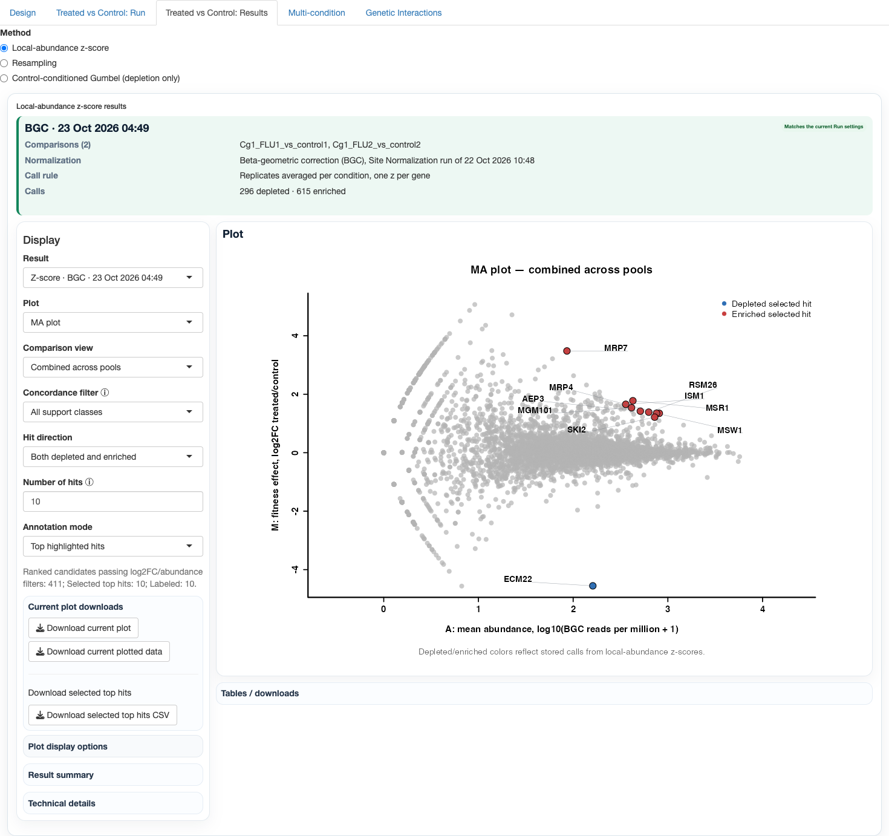

# Condition comparisons: treated vs control

YTAB compares treated libraries with their matched controls to find genes whose mutants are depleted (the gene helps
survive the treatment) or enriched (losing the gene helps). Three methods are offered. They answer slightly different
questions and were validated in a pre-registered benchmark.




| method | what it gives | normalization (default) | use it for |
|---|---|---|---|
| **Local-abundance z-score** | one z per gene, depleted/enriched calls by threshold; no p-values | BGC | ranking genes, comparison with published z-score screens |
| **Resampling** | site-restricted permutation test, p and BH q, both directions | BGC (trimmed-sum recentering) | hit lists with false-discovery control |
| **Control-conditioned Gumbel** | runs of depleted sites vs the controls' count model, p and q | TTR | depletion-only hit lists with strict error control |

## Input and design

A comparison design pairs each treated library with its control (background, pool). The CLI writes it with
`ytab comparisons`, and it can be edited in the app.

**Normalization:**
- **What it is:** any Site Normalization method.
- **How it enters the z-score:** the method's normalized site counts are summed per gene and expressed per million of
  the mean library total. The pseudocount (0.5) therefore means the same as with counts per million.
- **Default:** BGC (beta-geometric correction), which the benchmarks support (below).
- **Fallback:** total reads (CPM) needs no normalization run.

## Local-abundance z-score (Gale et al. 2020)

1. **Control noise model.** For each background, the two control libraries give A = mean abundance and M = log2 ratio
   (pseudocount 0.5). The running SD of M over 41 genes, ordered by A, is fitted as SD(A) = m1 + m2·A^m3. Low-count
   genes therefore get a wider noise band.
2. **Replicates averaged.** The replicate libraries of each condition are averaged, and each gene gets one
   log2FC = log2((treated + 0.5) / (control + 0.5)) and z = log2FC / SD(A). This is Gale's published procedure.
3. **Call.** |z| beyond the 99th percentile of the control–control |z| gives depleted or enriched.
4. **Top hits.** For labels, the heatmap and GO, the called genes with at least a 2-fold change are ranked by |z|
   (`top_hit_evidence.csv`).

The earlier per-pair rule ("consistent in all pairs" / "single pool") is available with `--combine pairs`, but made most
of the z-score's false calls in the benchmark.

## Resampling

A permutation test on the gene's normalized site counts, controls vs treated. Labels are permuted within each pool when
there are several. The test is two-sided, with Benjamini–Hochberg FDR. With BGC or aBGC, the treated libraries are recentred
(trimmed sum) so that typical genes show no change. Adapted from TRANSIT's resampling (DeJesus et al. 2015).

## Control-conditioned Gumbel

Finds each gene's longest run of consecutive depleted sites in the treated libraries and compares it with the longest
run expected from the controls' count model. It uses the exact tail probability, with the Gumbel fit as a diagnostic.
It tests depletion only, needs two or more controls per background, and accepts scalar normalizations (TTR, total
reads, nonzero mean). Adapted from TRANSIT's Gumbel method (DeJesus et al. 2013). Details: `docs/control_conditioned_gumbel.md`.

## Validation

**Pre-registered simulation benchmark** (Gale-calibrated; 140 signal and 40 null experiments; amended before
unblinding). Full results: `output/treated_vs_control/benchmark_blind_2026-10-22/RESULT.md`.

- **Normalization:** the beta-geometric corrections beat CPM and TTR for both the z-score (BGC: AUC +0.012 vs CPM) and
  resampling (+0.008 vs total reads). The adaptive form, aBGC, is within 0.01 AUC of BGC: slightly ahead in the
  simulations (z-score +0.0016, resampling +0.0028; R27), slightly behind on real data (SGD rapamycin AUC 0.590 vs
  0.597; `output/conditions/ADDENDUM_abgc.md`). BGC is the default.
- **Ranking:** the z-score with BGC ranks affected genes best (precision at K +0.086 over resampling).
- **Calls:** only resampling with BGC or aBGC (FDR 0.063 and 0.062) and the Gumbel with TTR (FDR 0.010) pass the
  calibration gates. The z-score has no error control: 64 false calls per null experiment with BGC (FDR 0.20).

**Real data** (Gale fluconazole; `output/treated_vs_control/benchmark_phase2_2026-10-22/RESULT.md`):
- **Published hits:** all methods recover Gale's published hits. Of the 19 strict hits, the z-score calls 19,
  resampling 18 and the Gumbel 15. UPC2A ranks first with the z-score.
- **Swap null** (control + FLU vs control + FLU): the z-score and the Gumbel make no calls, and resampling with BGC
  makes 7.

## Outputs the app reads

Every run writes the same tables, whatever the normalization, library or species, and the command fails if one is
missing (`src/ytab/fitness/contract.py`):
- **z-score:**
  - `zscore_manifest.json`;
  - the per-gene summary (call, effect, z, abundances);
  - per-pair and combined statistics;
  - gene values;
  - library sizes;
  - the control–control z;
  - the noise-model fit;
  - top-hit evidence.
- **Resampling / Gumbel:** `manifest.json`, `genes.tsv`, and per group `sites.tsv.gz`.

## Commands

```sh
python scripts/local/ytab.py fitness --project-config P/config/project.yaml --normalization betageom --normalization-run P/normalization/RUN
python scripts/local/ytab.py treated-vs-control --project-config P/config/project.yaml --method resampling \
  --normalization-run P/normalization/RUN --normalization betageom --output P/treated_vs_control/RUN
```

A figure of a result, as the app draws it:

```sh
python scripts/local/ytab.py figure treated-vs-control P/treated_vs_control/RUN P/config/project.yaml \
  --plot volcano --output volcano.svg
python scripts/local/ytab.py figure multi-condition --list
```

## Comet plots

A comet plot shows every gene's reads under treatment against its reads in the control, on log axes, one panel per
comparison. Genes that do not respond lie on the diagonal; because read totals span orders of magnitude the bulk of
them forms a dense elongated body along it, and the genes that do respond spray away from that body. The figure
therefore shows in one panel both how much evidence a gene carries, by how far along the diagonal it sits, and how
much it moved, by how far off the diagonal — which a volcano plot separates and a hit list discards.

It computes no statistic of its own. Both axes are columns the results table already carries, so **the app draws
it the moment it is selected** -- in Treated vs Control, and in Multi-condition for the chosen pair. There is
nothing to run first.

The gene-set overlay is assembled in the app from the GMT and orthology files that ship with the species, which are
the same files the command line reads; the two agree gene for gene (verified on Gale 2020: 5,234 of 5,234). In the
app you choose which sets to overlay from a searchable list, and you can paste your own gene names into
**Highlight my genes** to get an overlay of exactly those, which outranks the declared sets so a gene asked for by
name is never hidden inside a family.

`ytab comet` remains for publication figures and for stacking several runs in one panel set. It writes the table
first and draws from it, so that figure cannot disagree with the numbers behind it either.

**Where the overlay appears.** Treated vs Control and Multi-condition both have a *Comet (gene sets)* plot, the
latter for the pair chosen in **Pair**. Genetic interactions does not: its *Strain responses* plot is already the
same geometry with the two strains' responses on the axes rather than a control and a treated mean, so the diagonal
there reads "responds the same in both backgrounds" and distance from it **is** the interaction. The overlay is
therefore offered on that plot through **Colour by -> Gene set**, instead of as a second plot that would duplicate it.

```bash
python scripts/local/ytab.py comet RUN_DIR [RUN_DIR ...] \
  --gene-sets resources/species/<species>/genesets/core_families.gmt \
  --orthologs resources/species/<species>/orthologs/<table>.txt \
  --set-order ERG PDR_CDR_efflux mito_ribosome ribosome_40S \
  --label-sets ERG PDR_CDR_efflux --label-count 10 \
  -o OUT_DIR
```

One run directory gives one panel; several give a stacked figure with shared axes, which is how a set of strains or
conditions is compared. Panels are named after the run's `background`, or by `--labels`. With no `-o`, the output
lands in `<run>/comet`.

**Gene sets** are declared in GMT files under `resources/species/<species>/genesets/` (the MSigDB interchange format: set name, description, then members), so a
lab can supply or correct its own without touching code. A gene joins a set if the set names its identifier, its own
gene name, **or its ortholog's gene name in a reference species**. That last route is what makes the overlays usable
on a non-model organism: in *C. glabrata* 4,812 of 5,234 genes reach an *S. cerevisiae* ortholog while only about 746
carry a name in the reference annotation, so sets declared on ortholog names cover the genome and sets declared on
native names cover a seventh of it. A gene in several sets is drawn once, in the first set of `--set-order`.

`scripts/local/ytab_build_genesets.py` writes the GMT from **GO annotations**: it takes a GAF, the ontology, and
a TSV naming each set and its GO term. Annotations are propagated up the ontology through `is_a` and `part_of`
before a set is written, because a GAF records only the term a curator chose -- on *S. cerevisiae* that turns 9
genes annotated to "mitochondrial ribosome" itself into the 91 that belong to it, and 12 for "cell wall
organization" into 199. `regulates` edges are deliberately not followed: a gene that regulates a process is not
in it, and following them sweeps every regulator into the set.

The annotations are *S. cerevisiae*'s (`resources/species/cerevisiae/annotation/go/`), and reach other species
through the ortholog-name match above. That indirection is what makes the sets usable: *C. glabrata*'s own GO
from CGD is 45% root "unknown" terms and contains one mitochondrial-ribosome gene, against S. cerevisiae's 2.5%
and 91.

**Labels** are chosen by distance from the diagonal, never by a threshold on the statistic: the plot is read for
where genes sit, so a label rule tied to a call would hide a gene that moved a long way without reaching
significance. Three rules shape which genes are named.

*Per set, not per plot.* The count applies to each overlaid set separately. Pooling them lets a large family take
every label: a 90-gene ribosome set beside a 29-gene ergosterol set leaves the smaller one unnamed, which is
usually the one being asked about.

*Direction.* **Calls shown** in the app (`--direction` on the command line) restricts which hits may be named to
the depleted side, the enriched side, or both, as it does on the volcano and the MA plot. Every member of a set
stays **coloured** whichever direction is chosen: the overlay exists to show where a whole family sits, and hiding
half of it would make a family that moved look like one that did not.

*Support.* A gene must reach `--label-min-reads` (default 10) in one condition. A gene at one or two reads in both
has a large ratio for no reason but counting noise, and those pile up at the origin where their labels overlap.

Specific genes are always named whatever the rules above: **Highlight my genes** in the app, `--label-genes` on
the command line.

**How much of the plot a set covers.** A functional family is a small fraction and does not obscure the comet's
body: on *C. glabrata* (5,234 genes) efflux is 0.3%, ergosterol 0.5%, the mitochondrial ribosome 1.6%, DNA repair
6.1%. A compartment-level term does: mitochondrion (GO:0005739) reaches 1,070 genes, a fifth of the plot, which is
why it is not one of the default sets. There is no fixed limit; the distinction is a response versus a location.

## References

- DeJesus MA, Ioerger TR (2013). A hidden Markov model for identifying essential and growth-defect regions in bacterial
  genomes from transposon insertion sequencing data. BMC Bioinformatics 14:303.
- DeJesus MA, Zhang YJ, Sassetti CM, Rubin EJ, Sacchettini JC, Ioerger TR (2013). Bayesian analysis of gene
  essentiality based on sequencing of transposon insertion libraries. Bioinformatics 29:695–703 (the Gumbel method).
- DeJesus MA et al. (2015). TRANSIT. PLoS Comput Biol 11:e1004401.
- Gale AN et al. (2020). Identification of essential genes and fluconazole susceptibility genes in Candida glabrata by
  profiling Hermes transposon insertions. G3 10:3859–3870.
