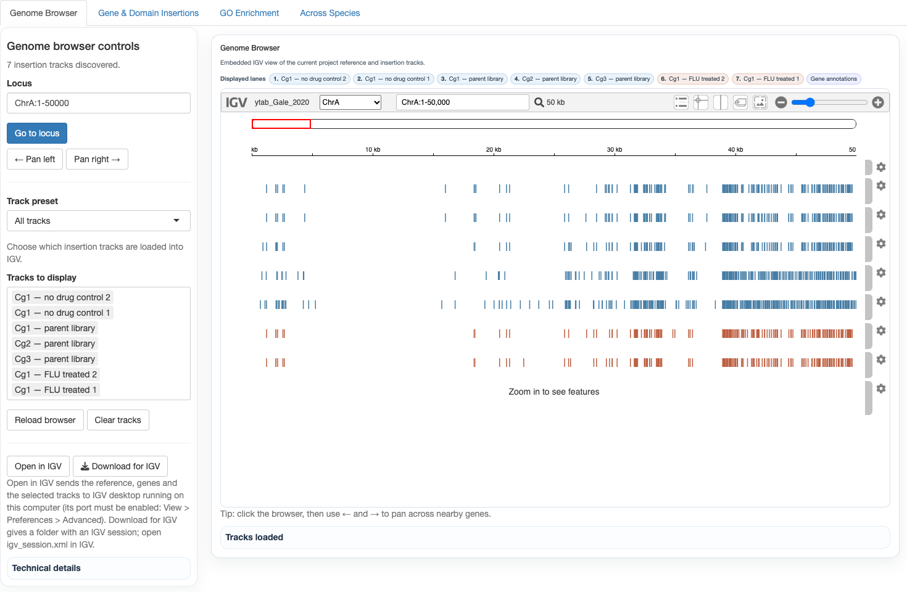

# Gene Explorer: genome browser, gene insertions, GO enrichment, across species

## Genome browser

An embedded IGV view (igv.js) of the project reference, its genes and each library's insertion sites. All files come
from one pipeline step, `ytab browser-tracks`, which the app runs when the browser opens. It rebuilds only when an
input changed. It writes to `<project>/genome_browser/`:
- **Reference:** the reference FASTA with display chromosome names (e.g. Chr A for CP048230.1), its index, and a
  chromosome alias table, so tracks using any chromosome name load.
- **Genes:** `genes.bed.gz`. Labels are the S. cerevisiae name when an ortholog is known, otherwise the gene's own name
  or ID. Genes are never dropped for lack of a name.
- **Insertion tracks:** one per library, made from its CreateHitFile hit table with each insertion site listed once.
- **IGV session:** `igv_session.xml`, which opens everything in IGV desktop.

**Open in IGV** sends the reference, the genes and the selected tracks at the current locus to IGV desktop on the same
computer (batch port 60151, enabled in View > Preferences > Advanced). **Download for IGV** zips the files with the
session.

## Gene & Domain Insertions

A figure of one gene: its insertion sites in each selected library, with flanking sequence and, when available, its
protein domains. Counts are insertion sites inside the gene; flank insertions are shown but not counted. Each figure,
with its table and manifest, is saved under the hash of its settings and reused when asked for again. The 500 most
recently used queries are kept per project.

## GO enrichment

Enrichment of a gene set against the annotated genome, using topGO:
- **Gene set:** the top hits from Condition Comparisons, or a pasted or uploaded gene list.
- **Test:** the *weight01* algorithm with Fisher's exact test, per ontology (BP, MF, CC). The classic Fisher p-value is
  shown alongside.
- **Mapping:** genes are mapped to S. cerevisiae ORFs through the species' annotation lookup.
- **Optional:** semantic reduction of significant terms with rrvgo (similarity threshold 0.7 by default).

## Across Species

A gene's results in every YTAB project of each species (essentiality prediction, fitness, insertions), via the
ortholog groups. It opens on the current project and its species.

## References

- Robinson JT et al. (2023). igv.js: an embeddable JavaScript implementation of the Integrative Genomics Viewer.
  Bioinformatics 39:btac830.
- Alexa A, Rahnenführer J (2023). topGO: Enrichment Analysis for Gene Ontology. Bioconductor.
- Sayols S (2023). rrvgo: a Bioconductor package for interpreting lists of Gene Ontology terms. microPublication
  Biology.
