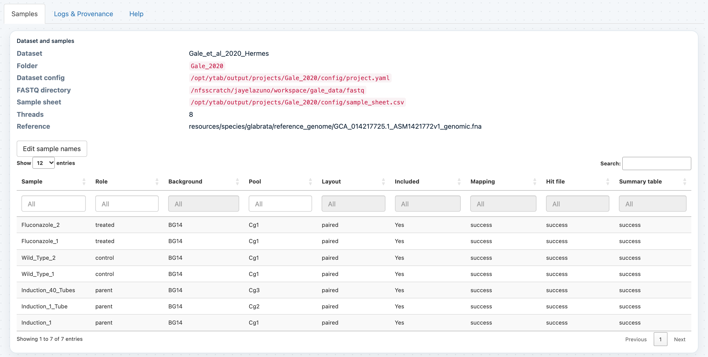
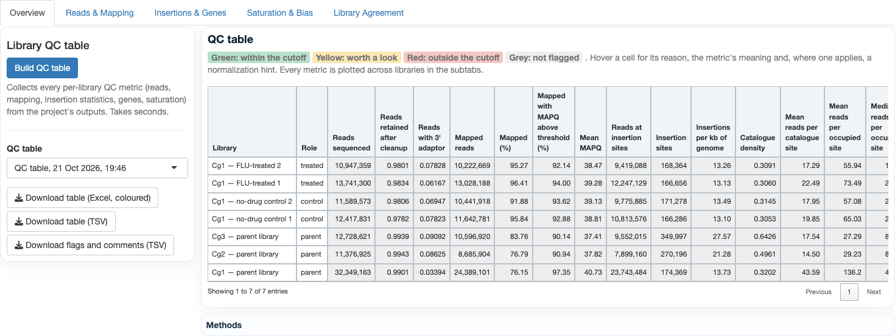
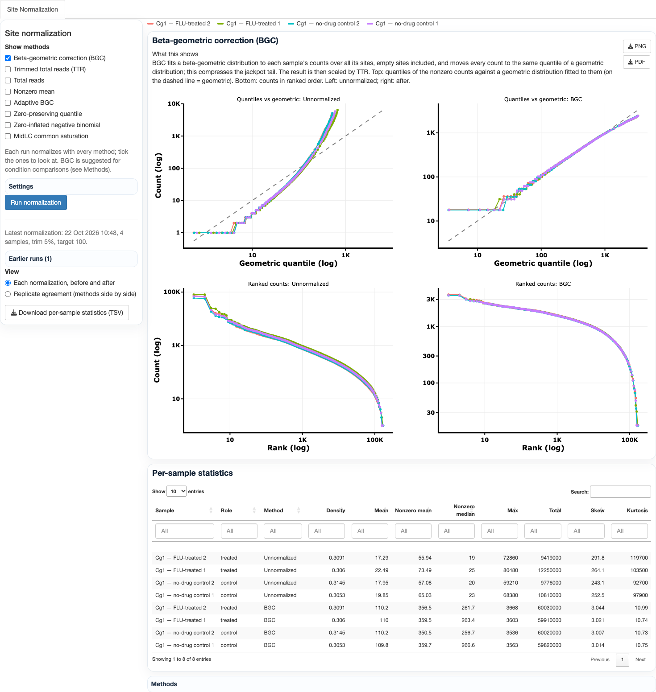
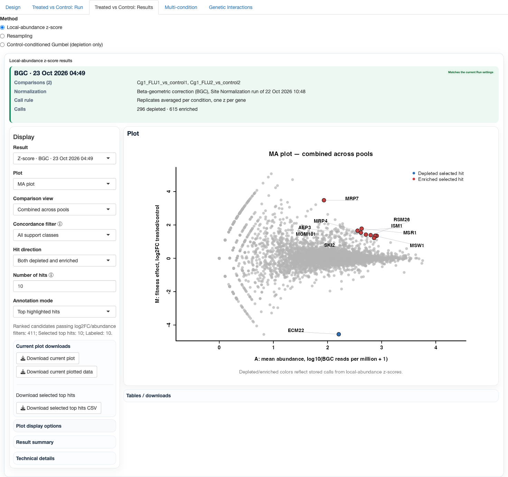
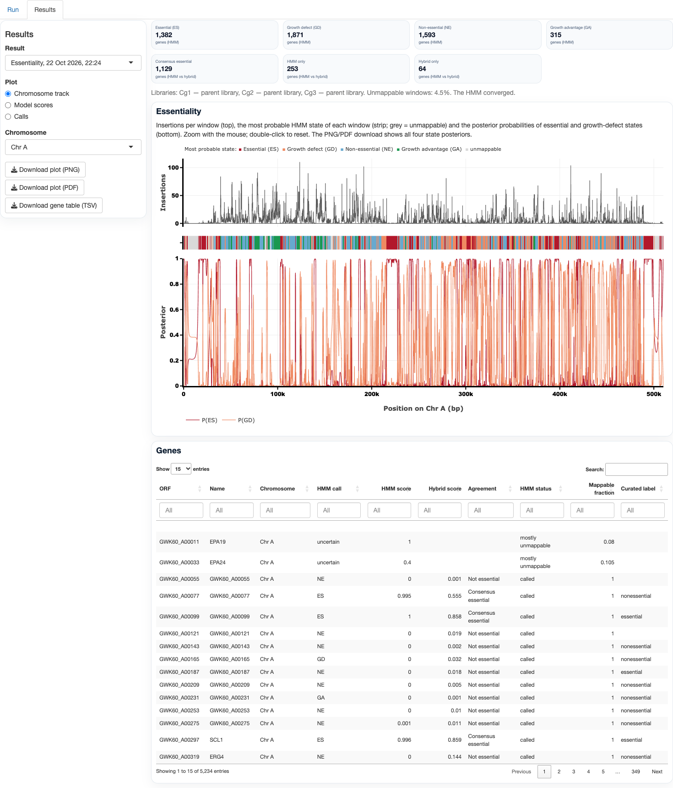
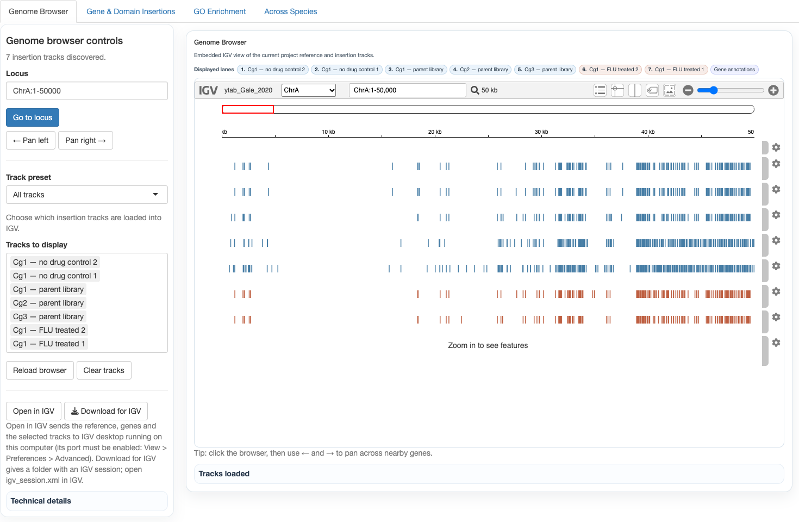
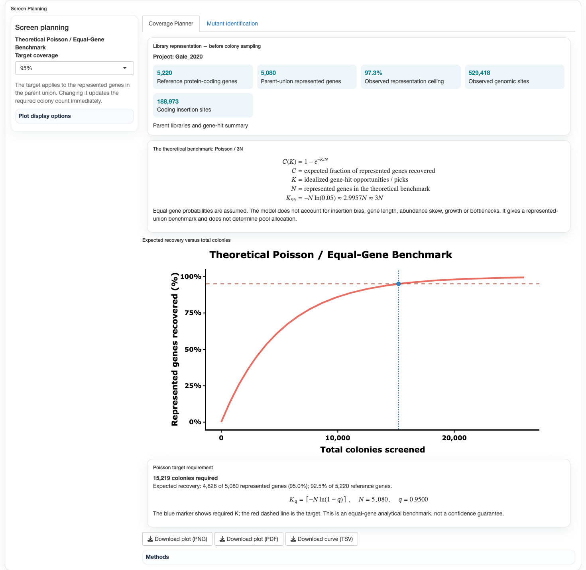
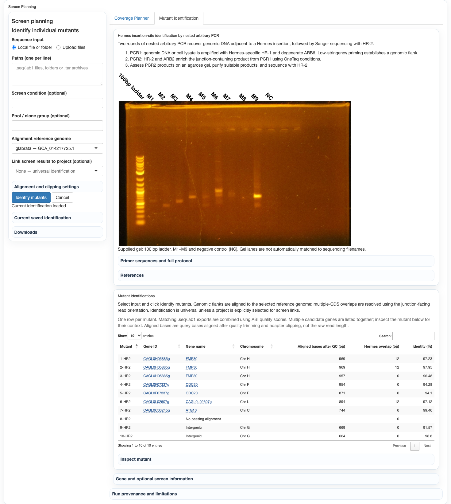

# Tutorial: Gale et al. 2020 from dataset to results

This walk-through uses the *C. glabrata* data of Gale et al. (2020) (strain BG2, pool Cg1), which ships as the example
dataset **Gale_et_al_2020_Hermes**:
- three untreated parent libraries (Cg1, Cg2, Cg3);
- two no-drug control cultures;
- two fluconazole-treated cultures.

Open YTAB, choose this dataset under **Open an existing YTAB dataset** on the landing page, and follow the tabs from
left to right. Every tab only displays results written by the YTAB pipelines. The same results can be made from the
command line (`python scripts/local/ytab.py <command> --help`), and the app picks them up.

## 1. Dataset

**Dataset › Samples** lists the samples, their roles (parent, control, treated), backgrounds and pools, and the
provenance of every input. Check the roles first: everything downstream (normalization groups, comparisons,
essentiality) relies on them. **Logs & Provenance** keeps the command behind each output, and **Help** is a quick
start for the dataset in front of you.

## 2. Run

**Run › Mapping** maps reads to the reference and writes per-sample hit files and SummaryTables, one sample at a time.
A run can be stopped and resumed, and it skips the stages a sample has already completed; **Run › Samples** chooses
which samples are included, and **Run › Reference** shows the genome and index in use. This dataset is already mapped.

To build a dataset of your own, use **Start from FASTQ** on the landing page: give it a folder, scan it, and tick the
FASTQ files to analyse. Files left unticked are still recorded as samples with `include=no`, so they can be taken up
later from **Run › Samples**. FASTQs stay where they are and are never uploaded.

## 3. Quality Control

The **Library QC table** has one row per library and one column per metric, each flagged:
- green: within the cutoff;
- yellow: worth a look;
- red: outside the cutoff.

Hover a cell for its reason and a normalization hint. The subtabs plot each metric across libraries: **Overview**,
**Reads & Mapping**, **Insertions & Genes**, **Saturation & Bias** and **Library Agreement**. **Build QC table**
recomputes the table, which is how a stored run picks up metrics added since it was made.

What to look for in this dataset:
- **Reads and mapping:** all seven libraries map well (76–96%). **Reads from the transposon donor (%)** counts the
  reads coming from the donor plasmid or locus rather than from a genomic insertion — plasmid that was never lost, or
  an unexcised donor. They are read off the donor sequence directly, with the transposon itself masked, so a read that
  merely carries the transposon end does not count. A high share means the induction left donor behind.
- **Insertion density:** the three parent pools have 170,000–350,000 insertion sites each. This is enough for
  essentiality calls.

## 4. Normalization

**Normalization › Site Normalization** runs every method on the dataset's libraries. Each method gets its own view of the libraries
before and after normalization. BGC (beta-geometric correction) is the default: it corrects the heavy-tailed
"jackpot" sites typical of Hermes pools, and it is the best normalization in the pre-registered benchmarks. The
**Top sites** subtab shows what the heaviest sites contribute and offers the optional top-site treatments
(winsorize, or drop the top sites) when one library is dominated by a few of them.

## 5. Condition Comparisons

**Design** pairs each treated library with its control. **Treated vs Control: Run** chooses the method and the
normalization (BGC from the latest Site Normalization run by default). **Treated vs Control: Results** then shows the
outputs below. Two further subtabs cover designs with more than one comparison: **Multi-condition** runs a permutation
ANOVA with all pairwise comparisons across a dose series or a mutant panel, and **Genetic Interactions** tests
strain × treatment designs.

- **The result box:** the comparisons, the normalization, the call rule and the call counts. If the shown result does
  not match the Run settings, the box says so.
- **The MA plot, scatter, heatmap and log2FC plots,** with the top hits labelled. Top hits are the called genes with
  at least a 2-fold change, ranked by |z| (as in Gale et al. 2020).

In the fluconazole comparison:
- **The top depleted gene is UPC2A,** the transcriptional regulator of ergosterol genes and the strongest hit in the published analysis. It is labelled ECM22, its S. cerevisiae ortholog name: C. glabrata genes are shown by their S.
  cerevisiae names, while S. cerevisiae, C. albicans and other species use their own (see *Gene names* in Methods).
- **Which method to use:** the z-score ranks genes best. For a hit list with false-discovery control, use resampling
  (BGC) or the control-conditioned Gumbel (TTR, depletion only). See *Condition comparisons* in Methods.

## 6. Essentiality

**Essentiality › Run** fits the Hermes window HMM to the parent libraries. It needs no training labels. Optionally it
also adds the hybrid model, where a species has curated labels. **Results** shows:
- the calls per state (essential, growth defect, non-essential, growth advantage);
- the agreement between the HMM and the hybrid;
- a chromosome track of insertions and state posteriors.

## 7. Gene Explorer

- **Genome Browser:** an embedded IGV view of the reference, the genes and each library's insertion sites. **Open in
  IGV** sends the same tracks to IGV desktop, and **Download for IGV** gives them as a folder with an IGV session.
- **Gene & Domain Insertions:** a figure of insertions across one gene and its domains.
- **GO Enrichment:** enrichment of the top hits or of a gene list.
- **Across Species:** a gene's results in the other species' datasets.

## 8. Screen Planning

**Coverage Planner** shows how many colonies a screen must pick to recover a target share of the represented genes
(Poisson, about 3N for 95%).

**Mutant Identification** maps Sanger reads from single mutants, recovered by nested arbitrary PCR, to their insertion
site and gene.

## Where to go next

- **Methods** (top right of the workspace, and on the landing page): every method, with its equations, validation and
  references.
- **Datasets**: the public Tn-seq datasets that ship with YTAB, with their designs and sources.
- **Search**: find a method, a metric, a command option, a dataset or a tab.
- **Command line:** `docs/command_line.md`, and `docs/cli_reference.md` for every command and option. Each tab's
  Technical details shows the command it ran.
