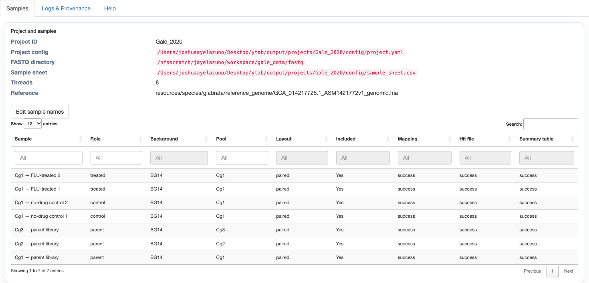
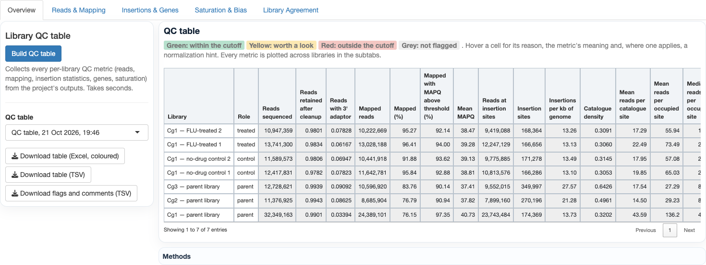
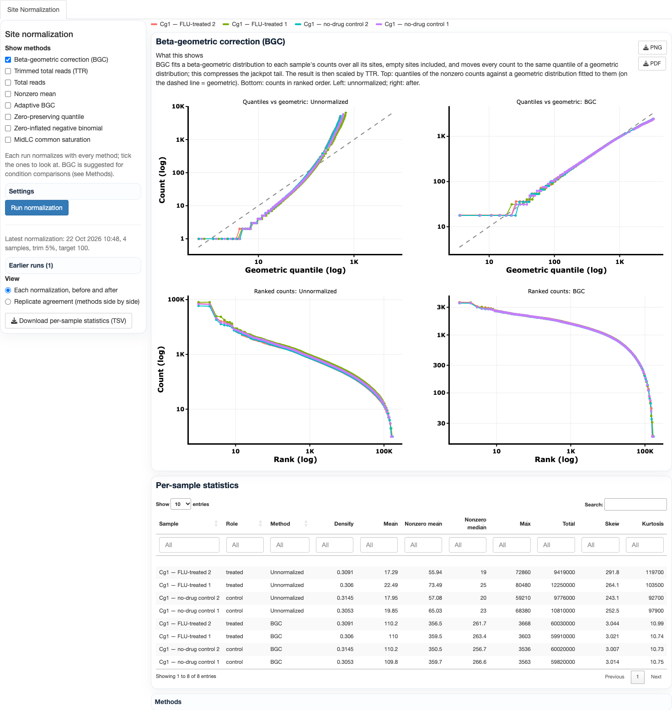
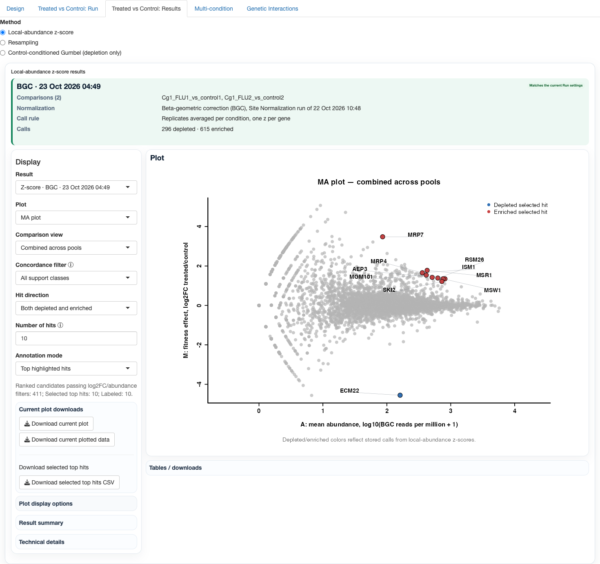
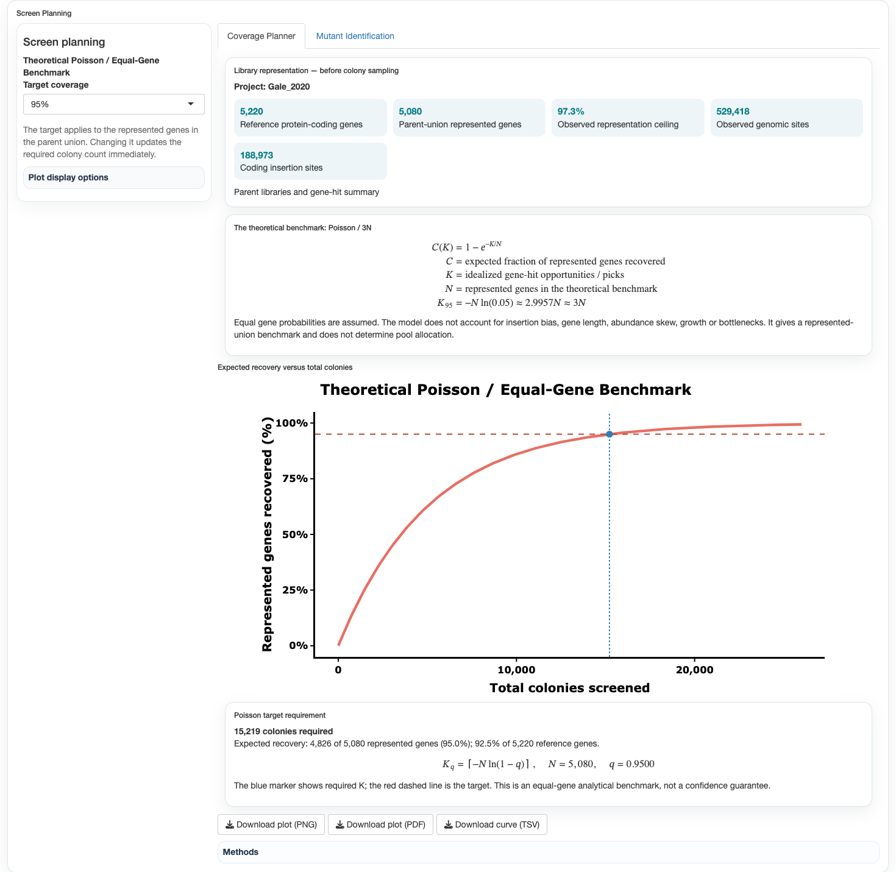

# Tutorial: Gale 2020 from project to results

This walk-through uses the C. glabrata data of Gale et al. (2020) (strain BG2, pool Cg1), which ships as the example
project `Gale_2020`:
- three untreated parent libraries (Cg1, Cg2, Cg3);
- two no-drug control cultures;
- two fluconazole-treated cultures.

Open YTAB, choose **Gale_2020** on the landing page and follow the tabs from left to right. Every tab only displays
results written by the YTAB pipelines. The same results can be made from the command line (`python
scripts/local/ytab.py <command> --help`), and the app picks them up.

## 1. Project

The Project tab lists the samples, their roles (parent, control, treated), backgrounds and pools, and the provenance
of every input. Check the roles first: everything downstream (normalization groups, comparisons, essentiality) relies
on them.

## 2. Run

**Run > Mapping** maps reads to the reference and writes per-sample hit files and SummaryTables, one job per sample.
The Gale project is already mapped. For a new project, start from FASTQ on the landing page.

## 3. Quality Control

The **Library QC table** has one row per library and one column per metric, each flagged:
- green: within the cutoff;
- yellow: worth a look;
- red: outside the cutoff.

Hover a cell for its reason and a normalization hint. The subtabs plot each metric across libraries (reads and
mapping, insertions and genes, saturation and sequence bias, library agreement).

What to look for in Gale:
- **Reads and mapping:** all seven libraries map well (76–96%).
- **Insertion density:** the three parent pools have 170,000–350,000 insertion sites each. This is enough for
  essentiality calls.

## 4. Normalization

**Site Normalization** runs every method on the project's libraries. Each method gets its own view of the libraries
before and after normalization. BGC (beta-geometric correction) is the default: it corrects the heavy-tailed
"jackpot" sites typical of Hermes pools, and it was the best normalization in the pre-registered benchmark.

## 5. Condition Comparisons

**Design** pairs each treated library with its control. **Treated vs Control: Run** chooses the method and the
normalization (BGC from the latest Site Normalization run by default). **Results** then shows the outputs below.

- **The result box:** the comparisons, the normalization, the call rule and the call counts. If the shown result does
  not match the Run settings, the box says so.
- **The MA plot, scatter, heatmap and log2FC plots,** with the top hits labelled. Top hits are the called genes with
  at least a 2-fold change, ranked by |z| (as in Gale et al. 2020).

In Gale's fluconazole data:
- **The top depleted gene is UPC2A,** the transcriptional regulator of ergosterol genes and the strongest hit in Gale's
  own analysis. It is labelled ECM22, its S. cerevisiae ortholog name.
- **Which method to use:** the z-score ranks genes best. For a hit list with false-discovery control, use resampling
  (BGC) or the control-conditioned Gumbel (TTR, depletion only). See *Condition comparisons* in Methods.

## 6. Essentiality

**Run** fits the Hermes window HMM to the parent libraries. It needs no training labels. Optionally it also adds the
hybrid model when curated labels exist. **Results** shows:
- the calls per state (essential, growth defect, non-essential, growth advantage);
- the agreement between the HMM and the hybrid;
- a chromosome track of insertions and state posteriors.

## 7. Gene Explorer

- **Genome Browser:** an embedded IGV view of the reference, the genes and each library's insertion sites. **Open in
  IGV** sends the same tracks to IGV desktop, and **Download for IGV** gives them as a folder with an IGV session.
- **Gene & Domain Insertions:** a figure of insertions across one gene and its domains.
- **GO Enrichment:** enrichment of the top hits or of a gene list.
- **Across Species:** a gene's results in other species' projects.

## 8. Screen Planning

**Coverage Planner** shows how many colonies a screen must pick to recover a target share of the represented genes
(Poisson, about 3N for 95%).

**Mutant Identification** maps Sanger reads from single mutants, recovered by nested arbitrary PCR, to their insertion
site and gene.

## Where to go next

- **Methods** (book icon at the top right): every method, with its equations, validation and references.
- **Search** (magnifier icon): find a method, a metric or a tab.
- **Command line:** `docs/command_line.md`. Each tab's Technical details shows the command it ran.
