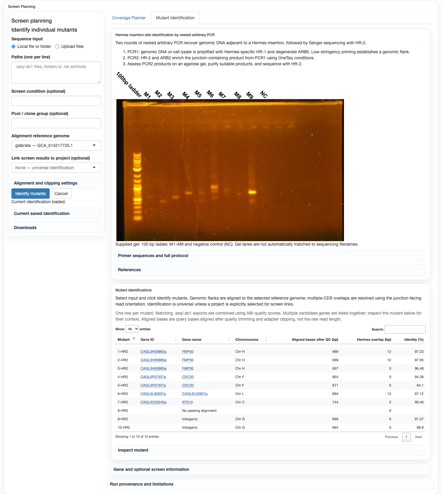

# Individual Hermes mutant identification

Screen Coverage → Mutant Identification summarizes the supplied
`data/mutant_screen/mutant_screen_method.pdf`: nested arbitrary PCR (HR-1/ARB6,
then HR-2/ARB2), product assessment with the supplied gel, and HR-2 Sanger
sequencing. References are Das et al. 2005 (10.1016/j.mimet.2005.02.011),
Martínez-García et al. 2014 (10.3389/fbioe.2014.00046), and Alejaldre et al. 2026
(10.1186/s44330-025-00054-3). Gel lane and read identities are not inferred.




Inputs: local files/folders, uploads, TAR/TAR.GZ/TGZ/ZIP archives, gzip-compressed
sequence files, FASTA/vendor `.seq`, plain DNA text, FASTQ and ABI/AB1 traces.
Archives are read in memory, with member/total-size limits and no extraction or
link following. Original inputs remain unchanged. Sequence-only files do not
contain per-base qualities; ABI/FASTQ qualities are used where available.

The backend adapts YTAB MapFastq's Cutadapt → Bowtie2 stages for longer Sanger
reads. Cutadapt uses accessioned Hermes terminal sequences from ENA L34807.1
and removes residual arbitrary-primer sequence. The supplied HR-2 leaves a
33 bp Hermes tail. A 12 bp exact terminal signature can clip noisy remnants,
but an exact junction needs at least 20 bp Hermes evidence and no local clipping
at the mapped query edge. Users may supply the actual complete cassette FASTA.
The 20 bp value is an adjustable review threshold, not a published biological
cutoff. Every read reports detected Hermes overlap and a specific review reason;
short/undetected Hermes sequence does not discard a passing genomic alignment.
The table's Hermes overlap is measured separately in original base calls before
quality trimming or adapter clipping, using the same terminal-match rules.
Post-QC overlap remains separate and continues to govern junction review. The
pre-QC diagnostic does not alter genomic flanks, alignment, or confirmation
thresholds. Older runs without this diagnostic show an unavailable value rather
than mislabelling post-QC overlap as pre-QC evidence.
Sufficient Hermes overlap with an unambiguous genomic flank is labelled supported.
If the alignment does not reach the clipped boundary, the label is instead
“Hermes overlap supported; exact junction position unresolved”; no exact insertion
base is invented. Ambiguous genomic mappings remain explicitly flagged.
Bowtie2 uses the selected reference genome's existing index, local FASTA alignment and up
to five placements. Ambiguous placements, weak alignments and insufficient
genomic sequence are retained as explicit outcomes. MAPQ 255 means unavailable,
not high confidence; alternate alignment scores are also checked.

Results distinguish supported junctions, mapped flanks with unconfirmed
junctions, intergenic neighborhoods and ambiguous/failed mappings. Coordinates
are 1-based reference bases adjacent to the junction; no guessed 8 bp
target-site-duplication correction is added. CDS/exon vs gene-span context and
multiple genuinely overlapping candidate genes are reported using the existing gene-domain annotation
adapter. A coding insertion does not automatically prove complete loss of function.
Mutant classification now reads explicit CDS, exon, intron and UTR features from
the selected reference's GFF/GTF. It does not use the gene's full span as a CDS
fallback. Coding-overlap counts and multiple-CDS resolution use aligned bases
within actual CDS blocks. Noncoding gene-span associations are distinguished
from intergenic alignments; confirmed intronic/UTR coordinates are not called CDS
hits. Reference assembly, strain and the 1-based inclusive coordinate convention
are recorded in provenance. CAGL aliases provide names, not coordinate conversion
between the BG2 alignment reference and CBS138/CGD annotations.

The junction-proximal resolution rule applies only when a mapped flank overlaps
multiple CDSs. A single-CDS flank match is retained unchanged and labelled
junction-unconfirmed if appropriate. For multiple CDSs, assignment prioritizes
the junction-facing read end, not every gene crossed by the full Sanger flank.
Defaults are a 100-query-base proximal window and at least
50 aligned reference-associated bases in that window; unaligned/soft-clipped
bases do not count as support. A confirmed insertion is assigned at its exact
adjacent base, including legitimate gene-edge insertions. Without a resolved
junction, the gene must contain the nearest aligned base and have at least 50
aligned bases of same-gene support within the proximal window. Such assignments
are explicitly provisional. In multiple-CDS cases, genes only farther downstream
are not assigned. Intergenic neighbors are never presented as insertion targets.
Whenever the exact junction is confirmed, its actual coordinate takes precedence
over a full-flank association, including if that junction is intergenic.

Detected Hermes terminal orientation takes priority. If Hermes is undetected,
the default assumes the original read start faces the junction, as in the HR2
protocol. Reverse-strand alignments are handled in query orientation, so the
junction-facing edge is not necessarily the lower genomic coordinate. Users may
choose read-end orientation for reverse-complemented input or require detected
Hermes orientation instead. Competing ends or insufficient proximal alignment
leave the gene unassigned. These thresholds are operational assignment rules,
not a statistical confidence level or proof of loss of function.

Native gene IDs can link to Fitness results and raw per-sample summaries only
after the user explicitly selects a project. No project is linked by default.
The user can then select a Fitness analysis; analysis/sample labels and source files
are retained. These are gene-level associations, not measurements of the clone's
phenotype. Condition and pool labels must be supplied by the user. A gene can be
opened in the existing Gene & Domain Insertion Explorer.
The UI reuses Fitness Screen's CAGL/gene-name lookup and expandable gene
descriptions, naturally orders numbered mutant labels, and uses the shared
S. cerevisiae common-name display with CAGL ID fallback. It uses the shared
conventional chromosome labels (Chr A–Chr M for this glabrata reference).
Identification shows one row per sequenced mutant, with multiple candidate genes
grouped in that row, original sequenced length, Hermes overlap, and alignment
identity. The table now shows aligned query bases after quality trimming and
does not include an exact-junction Status column. Reads mapping outside CDSs
show “Intergenic” instead of a blank gene name; failed/ambiguous mappings remain
distinguishable. Exact-junction evidence is retained in collapsed technical
details and downloadable provenance, not presented as a routine main-table warning.
The aligned length is measured after quality trimming and
adapter clipping, not raw base-call length. Failed alignments have no aligned
length rather than reporting the unaligned read length. Browser sorting uses a hidden numeric natural-order rank rather than
interpreting mutant labels as dates. Candidate-gene and Fitness summary tables
each show five columns. Additional alignment metrics are in the selected-mutant details; raw sample
insertion support is in a collapsed section. Native IDs and full evidence stay
in the downloadable run outputs.

The UI maintains one universal current result in `output/mutant_screen/current/`:
identification CSV, raw/end-trimmed and clipped FASTA, alignment SAM, Cutadapt
reports, tool logs and `results.json` containing references/hashes, input hashes,
thresholds, versions, commands and candidate/result evidence. Runs are explicit,
asynchronous, cancellable and retained for reload/download. A successful changed
request replaces the current result, retaining its predecessor in a recoverable
archive outside the UI; failed or cancelled requests preserve the current result.
Switching the open YTAB project does not clear or scope mutant identifications.
The reference-genome selector supplies the alignment configuration only. Screen
links are disabled by default and require explicit selection of a project using
the same reference genome. They do not modify
raw hit files, Poisson calculations or existing Fitness analyses.

Matching single-record `.seq` and `.ab1`/`.abi` filename stems are paired across
files or archives into one mutant record. ABI base calls and per-base qualities
drive QC/alignment; the sequence export corroborates those calls. Disagreements
are explicitly flagged, not combined into an invented consensus. Both source
identities and hashes remain in provenance. Either format works alone; ambiguous
same-stem groups are retained separately rather than guessing a pairing.

Identical requests reuse the universal current result.
The fingerprint includes member contents/identities (independent of upload
temporary paths or archive packing), scientific settings, reference and Hermes
hashes, gene annotations, tool versions, and linked Fitness/raw-summary content.
Reuse requires the identification CSV and clipped FASTA to remain available.
No new result directory is created on a cache hit. Older runs without the new
fingerprint are preserved; the first new request produces a versioned result,
and subsequent identical requests reuse it. The UI replaces changed settings or
content only after successful completion; a process lock prevents concurrent
replacement. Older per-project runs are archived outside the current-result UI.
Explicit CLI output directories still reject unrelated existing data unless
`--replace-current` is requested. `--project-config` supplies the reference only;
`--link-project-config` explicitly opts into screen associations.

Environment: Biopython, pysam, PyYAML, cutadapt and Bowtie2. The existing
`ytab-local` environment has been used for validation. Offline UI runs use the
bundled Hermes reference; no external sequence service is queried.

CLI:

```sh
python scripts/local/ytab_identify_mutants.py \
  --project-config output/projects/H2O2_screen_v1/config/project.yaml \
  --input data/mutant_screen/pfasta-Oct13-9-18-48.tar \
  --output /path/to/new/empty/run-directory
```
